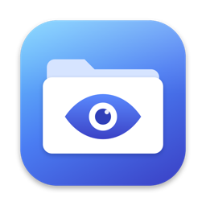
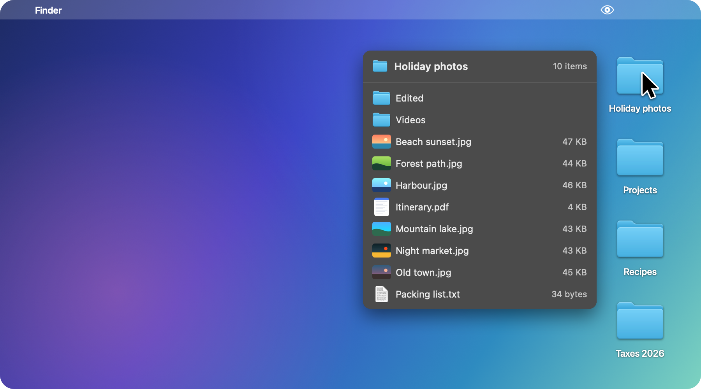

<p align="center">
  
</p>

<h1 align="center">Glimpse</h1>

<p align="center">
  <b>Rest the cursor on a folder and see what's inside.</b><br>
  No clicking, no new windows. Move away and it's gone.
</p>

<p align="center">
  macOS 14 or later · Apple Silicon · menu-bar app · Swift, no dependencies · MIT license
</p>

<p align="center">
  <a href="https://github.com/Saurabh-kayasth/Glimpse/actions/workflows/test.yml"></a>
</p>

<p align="center">
  
</p>

## What it does

- **Peek without opening.** Rest the cursor on a folder for about half a second and a panel opens beside it, listing
  what's inside: folders first, then files with their sizes, in Finder's order.
- **See pictures, PDFs and videos** as small previews, the same ones Finder makes.
- **Open anything with one click.** Files open in their usual app; subfolders open in Finder.
- **On the desktop and in Finder windows** shown as icons, on every connected screen.
- **Stays out of your way.** The panel never takes focus from the app you're typing in, never covers the icon, and
  hides the moment you move away.
- **Read-only.** Glimpse lists and opens. It never moves, renames, deletes or changes anything.
- **Light.** About 0.1 % CPU and 16 MB of memory while idle. Starts at login if you want it to.

## Install

Glimpse isn't on the Mac App Store, and can't be: it asks Finder what's under the cursor through Accessibility,
which App Store apps aren't allowed to do. It isn't notarized yet either, so for now you build it from source. It
takes about two minutes.

**You need** macOS 14 or later and Apple's command-line developer tools (Swift 6). Run `xcode-select --install` if
`swift --version` doesn't work.

```bash
git clone https://github.com/Saurabh-kayasth/Glimpse.git
cd Glimpse
tools/make-signing-cert.sh    # once: a local signing certificate, so permissions survive updates
./build.sh --run              # builds, installs ~/Applications/Glimpse.app and starts it
```

An eye appears in the menu bar. macOS then asks you to allow Glimpse in **System Settings → Privacy & Security →
Accessibility**. Switch it on, and the eye loses its warning badge. That's it: rest the cursor on a folder.

To update later, run `git pull` and `./build.sh --run` again. Your permissions stay.

## Permissions

| Permission | Why | When |
|---|---|---|
| **Accessibility** (required) | To ask Finder which icon is under the cursor | Once, on first launch |
| **Files and folders** (Desktop, Documents, Downloads, external and network drives) | To list a folder's contents | Once per location, the first time you preview a folder there |

Glimpse doesn't use Screen Recording, Input Monitoring or the network. It never reads your keyboard, never reads
other apps' windows, and asks Finder only about the spot under the cursor.

## Using it

| | |
|---|---|
| **Preview a folder** | Rest the cursor on it (icon or name) for about 0.35 s |
| **Scroll the list** | Move into the panel and scroll |
| **Open an item** | Click its row; a subfolder opens in Finder |
| **Close the panel** | Move away from the folder and the panel |

The menu-bar eye:

| Item | |
|---|---|
| **Hover Previews** | Turns previews on or off (the eye gets a slash when off) |
| **Accessibility** | Shows the permission's status, or a shortcut to grant it |
| **Finder Windows** | Also preview folders inside Finder windows in icon view |
| **Launch at Login** | Start Glimpse when you log in |
| **About Glimpse** · **Show Log** · **Quit** | |

## Privacy

- **Nothing leaves your Mac.** Glimpse has no network code.
- **Nothing is changed.** Listing a folder, drawing a preview (done by macOS's Quick Look) and opening an item on
  click are the only things it does with your files.
- **The log stays local** (`~/Library/Logs/Glimpse.log`; past 1 MB it moves to `Glimpse.old.log`) and records the
  folder paths you hover, so you can see what it did.

## Troubleshooting

| What you see | Try this |
|---|---|
| The eye has a warning badge | Allow Glimpse in System Settings → Privacy & Security → Accessibility |
| Nothing happens on the desktop | The desktop must be visible at that spot: windows cover desktop icons. Press **fn F11** (Show Desktop) |
| Nothing happens in a Finder window | Only icon view (**⌘1**) is supported. Check **Finder Windows** is ticked in the menu |
| "Can't read this folder" | Allow Glimpse in System Settings → Privacy & Security → Files and Folders |
| Asked for Accessibility after every update | Run `tools/make-signing-cert.sh` once, then `./build.sh --run` |
| The eye is missing from the menu bar | On Macs with a notch, macOS hides icons that don't fit. Quit another menu-bar app |
| Something else | Menu → **Show Log**. For more detail: `defaults write local.glimpse.app verboseHoverLog -bool true`, then quit and reopen Glimpse |

## Uninstall

```bash
pkill -x Glimpse
rm -rf ~/Applications/Glimpse.app
tccutil reset All local.glimpse.app          # forget its permissions
defaults delete local.glimpse.app            # forget its settings
rm -f ~/Library/Logs/Glimpse*.log
```

If you'd switched on **Launch at Login**, also remove Glimpse in System Settings → General → Login Items &
Extensions. The signing certificate is in Keychain Access → login → My Certificates → "Glimpse Local".

## How it works

macOS has no "cursor is over this desktop icon" event, so Glimpse works it out itself. It watches the cursor 20 times
a second. When the cursor rests, it checks the window list to see whether the desktop or a Finder window is showing
there. Then it asks Finder, through Accessibility, which item is at that point. If it's a folder, Glimpse lists it in
a floating panel placed beside the icon on the same screen.

The full story is in **[docs/](docs/README.md)**: what was measured on a real Mac, the design step by step, the
architecture diagram, every decision with its reason, and one write-up per build step with its test results.

## Development

```bash
swift test          # 52 tests: which item is under the cursor, panel placement, screens, Finder views, previews
./build.sh --run    # build, sign, install, run
```

| Folder | |
|---|---|
| [Sources/GlimpseCore/](Sources/GlimpseCore/DesktopRules.swift) | The rules, as plain tested functions: desktop vs. window vs. other, which item, where the panel goes, when it hides, which files get previews |
| [Sources/Glimpse/](Sources/Glimpse/AppDelegate.swift) | The app: menu bar, cursor watching, Accessibility, the panel, Quick Look |
| [Tests/GlimpseCoreTests/](Tests/GlimpseCoreTests/DesktopRulesTests.swift) | Tests, many built from what Finder really reported on a test Mac |
| [tools/](tools/) | The signing certificate, the icon and README image generators, and probes used while building |
| [docs/](docs/README.md) | Design, decisions, rollout log |

Developer launch options, for checking things without hovering: `--simulate-hover <folder> <x> <y> <w> <h>`,
`--simulate-click <row>`, `--snapshot <png>` and `--dump-finder-shapes <file>`. They're described at the top of
[AppDelegate.swift](Sources/Glimpse/AppDelegate.swift). The icon, the picture above and the link-preview card are drawn by
`swift tools/make-icon.swift`, `swift tools/make-hero.swift <panel.png>` and `swift tools/make-social.swift`. Every
push runs the tests on GitHub Actions ([.github/workflows/test.yml](.github/workflows/test.yml)).

## Limitations

- **Finder windows in list, column and gallery view** aren't supported yet, only icon view.
- **Sharing a built copy with another Mac** needs Apple's Developer ID signing and notarization, which isn't set up.
  Until then, each Mac builds its own.
- **It depends on how Finder describes its icons.** Built and tested on macOS 26.4.1. A future macOS could change
  that; the logic lives in one file ([DesktopRules.swift](Sources/GlimpseCore/DesktopRules.swift)), and the log says
  what Finder reported when something isn't recognised.

## License

[MIT](LICENSE) © 2026 Glimpse contributors.
