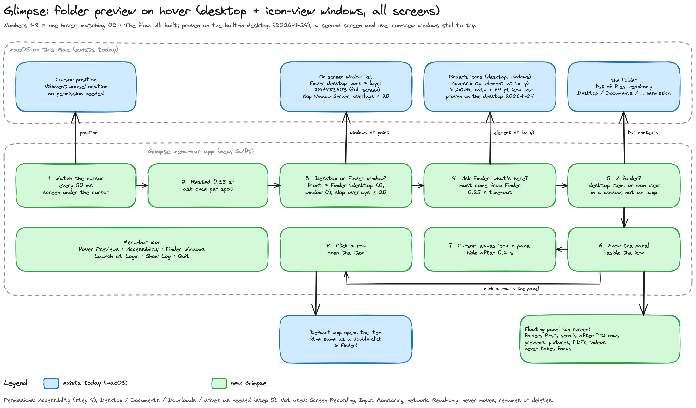

# 02 · Design: a menu-bar app that asks Finder what's under the cursor

[← Back to the overview](README.md) · Before this: [01 · the desktop today](01-current-macos-desktop.md)



Source: [diagrams/glimpse-architecture.excalidraw](diagrams/glimpse-architecture.excalidraw) (edit on excalidraw.com,
export the PNG over the old one).

## In one sentence

A small Swift app in the menu bar watches the cursor. When the cursor rests on the desktop, on any screen, it asks
Finder which item is there. If the item is a folder, it shows the folder's contents in a floating panel next to the
icon. In plain words: it's a museum guide that asks the guard "what's hanging here?" whenever you stop walking. The full
walk-through: [00](00-hover-preview-explained.md).

## The flow, step by step

Numbers match the diagram.

| # | Step | Detail | Built in |
|---|---|---|---|
| 1 | Watch the cursor | A timer reads the cursor position 20 times a second (every 50 ms). Reading the position needs no permission and costs almost nothing. Use the screen under the cursor and skip its menu bar ([D1](03-rollout-plan.md#decisions), [P4.1](rollout/P4.1-all-screens.md)). | [P1.3](03-rollout-plan.md#p13-hover-detection) |
| 2 | Wait for it to rest | Do nothing until the cursor has stayed within **3 points** of the same spot for **0.35 s** ([D7](03-rollout-plan.md#decisions)); a finger resting on the trackpad wobbles the cursor by fractions of a point. Ask once; if nothing is found, ask again every 0.6 s, up to 3 more times, while the cursor stays put (a window may still be sliding away after Show Desktop). Fixed in [F1](rollout/F1-hover-reliability.md). | [P1.3](03-rollout-plan.md#p13-hover-detection) |
| 3 | Is the desktop, or a Finder window, showing here? | Walk the on-screen window list front to back. Skip our own panel and Window Server's own layers (the 81-point strip, [Q2](03-rollout-plan.md#open-questions)). The first window that contains the point must be **Finder's**: on a layer below 0 it's the desktop, on layer 0 or above a Finder window ([D5](03-rollout-plan.md#decisions), since [P5.1](rollout/P5.1-finder-windows-icon-view.md)). A widget or another app's window there means no. **Found 2026-11-24:** the Dock has a full-screen window at layer 20 in front of everything ([01](01-current-macos-desktop.md#the-desktop-is-a-stack-of-windows)), so the rule **also skips the Dock's layer-20 window** (built in [P1.3](rollout/P1.3-hover-detection.md#how-the-design-changed-from-the-plan-and-why)). That lets the Dock's own tiles through, so step 4 must confirm. | [P0.2](03-rollout-plan.md#p02-is-the-desktop-showing-at-this-point) proves it, [P1.3](03-rollout-plan.md#p13-hover-detection) builds it |
| 4 | Ask Finder what's at the point | Accessibility: "element at position (x, y)", asked of the **whole system**: it returns what's really on top, so a Dock tile or a widget answers as itself. Check the answer comes from Finder. (Asking Finder alone sees through windows in front: [P0 run](rollout/P0.1-ax-probe.md#first-run-2026-11-24-0559-utc).) Read the item's path (`AXURL`), file name (`AXFilename`) or shown name (`AXTitle`), and its box (`AXPosition` + `AXSize`). If the hit is the label, step up to its parent (at most 3 levels). | [P0.1](03-rollout-plan.md#p01-ask-finder-what-is-under-the-cursor) proves it, [P1.3](03-rollout-plan.md#p13-hover-detection) builds it |
| 5 | Is it a folder? | On the desktop: turn the answer into a path in `~/Desktop`; a shown name without an extension is matched against the folder's files and their shown names. In a Finder window: only an icon-view item with a real path counts (an `AXImage` inside an `AXList/AXCollectionList`, [P5.1](rollout/P5.1-finder-windows-icon-view.md)). Follow aliases and symlinks. Keep only real folders: not `.app` bundles or other packages, which look like files in Finder. | [P1.3](03-rollout-plan.md#p13-hover-detection) |
| 6 | Show the panel | Read the folder's list (hidden files skipped; folders first, then by name the way Finder sorts). Show a floating panel beside the icon. It goes to the left when the icon is near the right edge, which is where desktop icons usually are, and stays inside the usable area of the icon's screen. | [P1.2](03-rollout-plan.md#p12-preview-panel), placed in [P2.1](03-rollout-plan.md#p21-hover-shows-the-panel) |
| 7 | Hide it | Hide when the cursor has been outside **both** the icon's box and the panel for **0.2 s**. The short grace lets the cursor cross the gap into the panel. | [P2.1](03-rollout-plan.md#p21-hover-shows-the-panel) |
| 8 | Click to open | Clicking a row opens that item with its default app, the same as double-clicking it in Finder. A subfolder opens in a Finder window ([D8](03-rollout-plan.md#decisions)). The panel then hides. | [P2.2](03-rollout-plan.md#p22-click-to-open) |

```
cursor ──50 ms──▶ moved? ── yes ─▶ reset rest timer
                    │ no (within 3 pt), rested 0.35 s; asked here? found nothing → again every 0.6 s, 3×
                    ▼
   on a screen, not its menu bar? ─ no ─▶ stop
                    ▼
   front window at point = Finder, layer < 0? ─ no ─▶ stop   (skip own panel + Window Server)
                    ▼
   Finder: element at point ──▶ path / name + icon box ─ none ─▶ log it, stop
                    ▼
   folder (not package)? ─ no ─▶ stop
                    ▼
   list contents ──▶ panel beside icon ──▶ hide 0.2 s after leaving icon + panel
```

## The panel

- **A non-activating floating panel** (`NSPanel` with `.nonactivatingPanel`). It floats above windows and doesn't take
  focus from the app you're using. It shows on every Space and never appears in ⌘-Tab.
- **A list**, not an icon grid ([Q6](03-rollout-plan.md#open-questions)): icon, name, and size for files. 300 points
  wide, rows 28 points tall. It grows to about 12 rows, then scrolls. Pictures, PDFs and videos show a Quick Look
  preview instead of their icon, loaded in the background ([D9](03-rollout-plan.md#decisions), [P6.1](rollout/P6.1-thumbnails.md)). The largest folder today has 64 items
  ([01](01-current-macos-desktop.md#whats-on-the-desktop)).
- **Header**: folder icon, name, item count ("47 items").
- **Empty folder** shows "Empty folder". **Unreadable folder** shows "Can't read this folder" instead of failing.
- Material background (the frosted look of macOS menus), rounded corners, shadow.

## Permissions

| Permission | Why | When it's asked | Without it |
|---|---|---|---|
| **Accessibility** | Step 4: ask Finder what's at a point | First launch: macOS shows a prompt that links to System Settings → Privacy & Security → Accessibility | The app runs but does nothing. The menu shows "Grant Accessibility Access…" |
| **Desktop folder** | Step 6: read a desktop folder's list | The first time a folder is previewed (macOS's standard "would like to access files in your Desktop folder") | The panel shows "Can't read this folder" |

Not needed: Screen Recording (we never read window titles or pixels), Input Monitoring (we read the cursor position,
not keys or clicks), Automation (we don't send AppleScript to Finder).

**The re-grant catch, and its fix.** Signed ad hoc (no certificate), the app is identified by a fingerprint of its
exact build, so every rebuild looked like a new app and the Accessibility grant silently stopped working. Since
2026-11-24 builds are signed with a local certificate, "Glimpse Local" ([D4](03-rollout-plan.md#decisions)). macOS
then identifies the app by its bundle id plus that certificate, and grants survive rebuilds
([P3.2](rollout/P3.2-stable-signing.md)).

## Proven on this Mac (2026-11-24)

```bash
cd Glimpse
swift tools/window-check.swift
```

| Check | Result |
|---|---|
| The probe app builds, signs ad hoc and logs windows and both rules without any permission | ✅ 2026-11-24 ([P0 probe](rollout/P0.1-ax-probe.md#tests-2026-11-24)) |
| Finder owns one full-screen window at macOS's desktop-icon level | ✅ layer -2147483603, 1470 × 956 |
| Something sits between the icons and app windows | ✅ a widget (Notification Centre, 180 × 180) and a Window Server strip (top 81 points) |
| Window list readable without Screen Recording | ✅ owner, layer, bounds yes; names hidden (not needed) |
| Finder answers "what's at this point" for desktop icons | ❓ **not verified**: needs Accessibility, which this session lacks → [P0.1](03-rollout-plan.md#p01-ask-finder-what-is-under-the-cursor) |
| The Window Server strip doesn't block the top row | ❓ **not verified** → [P0.2](03-rollout-plan.md#p02-is-the-desktop-showing-at-this-point) |
| Nothing else sits in front of the whole screen | ❌ **the Dock does**: a 1470 × 956 window at layer 20, above all app windows (2026-11-24, [P0 probe](rollout/P0.1-ax-probe.md)). The rule as written says "no" everywhere; P0.2 tests a version that skips it. |

## Cost

- **CPU**: one cursor read every 50 ms, plus one window-list read and one Accessibility question each time the cursor
  rests. Target: **under 1% CPU** while idle. **Measured 2026-11-24: 0.0–0.2 % (mostly 0.1 %)**
  ([P2.1](rollout/P2.1-hover-shows-panel.md#tests-2026-11-24)).
- **Memory**: a small AppKit + SwiftUI app. **Measured 2026-11-24: 16 MB** ([P2.1](rollout/P2.1-hover-shows-panel.md#tests-2026-11-24)).
- **Money**: none. The local certificate is free. A paid developer account is only needed to share the app with other Macs.

## Why not the other ways

- **Finder's floor plan (AppleScript)**: goes stale when icons move, gives only icon centres, and needs the Automation
  permission. It's the fallback if [P0.1](03-rollout-plan.md#p01-ask-finder-what-is-under-the-cursor) fails.
  [Compared](00-hover-preview-explained.md#the-options-side-by-side).
- **Our own desktop**: replaces Finder's desktop. Far too much work for a hover panel.
- **Quick Look plug-in**: Quick Look only runs when you press Space on a selected item. It can't react to hovering.
- **Finder extension (Finder Sync)**: adds toolbar buttons, badges and menu items to Finder windows. It gets no hover
  events and doesn't apply to desktop icons.
- **Electron or a web app**: can't use the Accessibility API or AppKit panels without native code anyway, at many
  times the memory.

## Safety rules

1. **Read-only** ([D6](03-rollout-plan.md#decisions)). The app lists folder contents and opens items on click. It never
   moves, renames, deletes or writes into your folders. Enforced in [P1.2](03-rollout-plan.md#p12-preview-panel).
2. **Only ask Finder, only at the cursor.** Accessibility questions go to the element under the cursor, and the app
   uses the answer only when it comes from Finder's process. It never reads other apps' windows or text. Enforced in
   [P1.3](03-rollout-plan.md#p13-hover-detection).
3. **No keys, no clicks.** It doesn't watch the keyboard or intercept mouse clicks outside its own panel.
4. **Nothing leaves the Mac.** No network access. The log (`~/Library/Logs/Glimpse.log`) holds element descriptions
   only when an icon can't be recognised. Capped in [P1.3](03-rollout-plan.md#p13-hover-detection).
5. **Easy off.** The menu-bar icon turns previews off or quits. Removing the app and its Accessibility entry undoes
   everything.

## What could break it

| Risk | What happens | Mitigation |
|---|---|---|
| A macOS update changes how Finder describes icons | Hovering stops finding folders | All of it lives in one function (step 4–5). It logs what it saw, so the fix is usually a few lines ([P1.3](03-rollout-plan.md#p13-hover-detection)) |
| Finder is busy (copying, slow network disk) | Accessibility question blocks | 0.25 s time-out on each question ([P1.3](03-rollout-plan.md#p13-hover-detection)) |
| A rebuild invalidates Accessibility | App silently does nothing | Build script resets the grant; menu shows status ([P1.1](03-rollout-plan.md#p11-app-skeleton)); lasting fix [P3.2](03-rollout-plan.md#p32-a-grant-that-survives-rebuilds) |
| Shown name ≠ file name (hidden extensions) | Wrong or no match | Match on shown names too; folders rarely have extensions ([P1.3](03-rollout-plan.md#p13-hover-detection)) |
| Panel steals focus or covers what you're doing | Annoying | Non-activating panel, hides within 0.2 s of leaving, menu toggle |

Next: [03 · rollout plan](03-rollout-plan.md).
