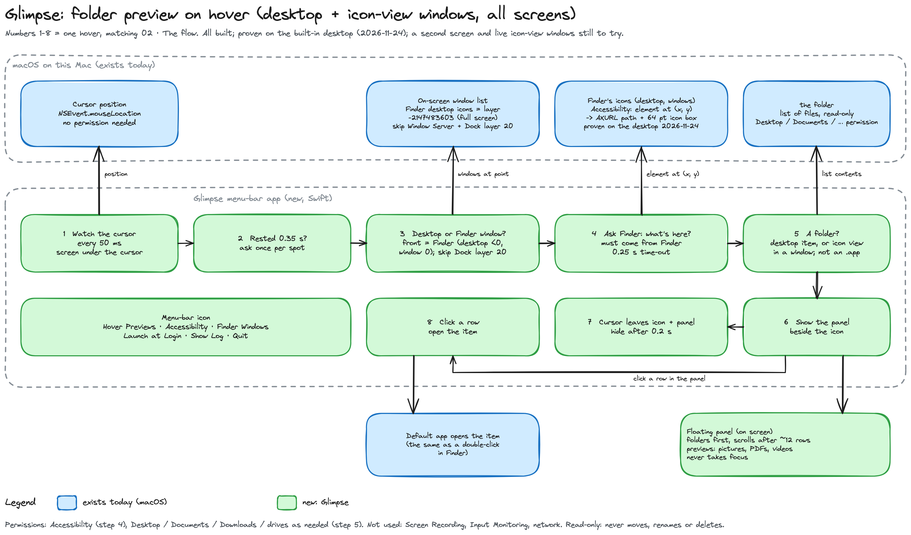

# Glimpse: folder previews on hover

[← Back to the repo](../README.md)

> **About this folder.** This is Glimpse's development log, kept while it was built in November 2026: what was
> measured on a real Mac, the design, every decision with its reason, and one write-up per build step with its tests.
> It was written for the maintainer, so "you" means them, and the times are UTC. To *use* Glimpse, the
> [main README](../README.md) is all you need.

Glimpse is a small menu-bar app for macOS. When you rest the cursor on a folder on the desktop, a panel opens next to
it listing what is inside. Started 2026-11-24. Status (2026-11-24): **it works on the real desktop** (rest on a folder,
its panel opens in about 0.4 s; click a row to open it; [test results](rollout/P2.1-hover-shows-panel.md#real-desktop-test-2026-11-24-07310739-utc)). Launch at login is built
([P3.1](rollout/P3.1-launch-at-login.md)), waiting for your log-out/log-in check. [Step tracker](rollout/README.md).

**Main finding so far (2026-11-24):** macOS has no "the cursor is over this desktop icon" event for apps. The app has
to work it out itself: watch the cursor, then ask Finder what sits under it. Finder answers that question through the
**Accessibility API**, the same interface screen readers use. The part I could check without permissions works on this
Mac ([01](01-current-macos-desktop.md)). The Accessibility part is **not verified yet**. It needs a permission this
session doesn't have, so step [P0.1](03-rollout-plan.md#p01-ask-finder-what-is-under-the-cursor) proves it first.

Editable source: [diagrams/glimpse-architecture.excalidraw](diagrams/glimpse-architecture.excalidraw). Open it at
excalidraw.com (menu → Open) or in the VS Code Excalidraw extension, edit it, then export the PNG again (scale 2×) over
`glimpse-architecture.png`.

## The short answers

**Can an app show a folder's contents when you hover over it on the desktop?** Yes, as a separate app running in the
background. Finder can't be changed, so the app watches the cursor, asks Finder which icon is under it, and draws its
own floating panel. Details: [00 · in plain words](00-hover-preview-explained.md).

**What does the user have to allow?** Two prompts, once each: **Accessibility** (to ask Finder what is under the cursor)
and **access to the Desktop folder** (to read the folder's list of files). Details:
[02 · Permissions](02-design.md#permissions).

**Which screens?** All of them, since 2026-11-24 ([D1](03-rollout-plan.md#decisions), [P4.1](rollout/P4.1-all-screens.md)): the panel opens
on the screen of the icon you rest on. This Mac had one screen when it was built: the built-in display, 1470 × 956
points.

**Can it go on the Mac App Store?** No. App Store apps run sandboxed, and a sandboxed app can't use the Accessibility API
this way. It runs as your own app, built from this folder.

**Will a macOS update break it?** It might. The app relies on how Finder describes its desktop icons, and Apple doesn't
promise to keep that the same. The code that depends on it stays in one place, and it writes a log line when it can't
recognise an icon ([02 · Risks](02-design.md#what-could-break-it)).

## What we decided

| Decision | Short reason |
|---|---|
| [D1](03-rollout-plan.md#decisions) All screens | Decided 2026-11-24 (was: main screen only). Built in [P4.1](rollout/P4.1-all-screens.md). |
| [D2](03-rollout-plan.md#decisions) Native Swift menu-bar app *(proposed)* | Needs AppKit floating panels and the Accessibility API; Xcode 26.4.1 and Swift 6.3.1 are installed. |
| [D3](03-rollout-plan.md#decisions) Ask Finder through Accessibility *(proven 2026-11-24)* | The only way that follows icons wherever Finder puts them. [Why not the others](00-hover-preview-explained.md#the-options-side-by-side). |
| [D4](03-rollout-plan.md#decisions) Sign with a local certificate, "Glimpse Local" | Decided 2026-11-24. Grants survive rebuilds. |
| [D5](03-rollout-plan.md#decisions) Desktop, and Finder windows in icon view | Decided 2026-11-24 (was: desktop only). Built in [P5.1](rollout/P5.1-finder-windows-icon-view.md). |
| [D6](03-rollout-plan.md#decisions) Read-only *(proposed)* | The app lists names and opens items when clicked. It never moves, renames or deletes anything. |
| [D8](03-rollout-plan.md#decisions) A subfolder click opens it in Finder | Decided 2026-11-24. Any click then hides the panel. |

## Reading order

| # | Doc | What's in it |
|---|---|---|
| 0 | [00 · in plain words](00-hover-preview-explained.md) | **Start here.** How an app can tell what you're pointing at, and the three ways to do it |
| 1 | [01 · the desktop today](01-current-macos-desktop.md) | How macOS stacks the desktop's layers on this Mac, checked 2026-11-24, and what's missing |
| 2 | [02 · design](02-design.md) | The app step by step, what's proven, permissions, risks |
| 3 | [03 · rollout plan](03-rollout-plan.md) | Decisions, phases and steps with "done when", open questions |
| - | [rollout/](rollout/README.md) | Step tracker; one doc per step, written as it's built |
| - | [tools/window-check.swift](../tools/window-check.swift) | Read-only check of screens and desktop layers (no permissions needed) |
| - | [Sources/Glimpse/](../Sources/Glimpse/AppDelegate.swift), [build.sh](../build.sh) | The app ([P1.1](rollout/P1.1-app-skeleton.md)) |
| - | [tools/ax-probe/](../tools/ax-probe/main.swift) | The P0 probe app and its log checker ([step doc](rollout/P0.1-ax-probe.md)) |

## Phases

| Phase | What | Status |
|---|---|---|
| [P0](03-rollout-plan.md#phase-p0-prove-it) | Prove Finder tells us which icon is under the cursor | ✅ 2026-11-24 |
| [P1](03-rollout-plan.md#phase-p1-building-blocks) | App skeleton, preview panel, hover detection, each testable alone | ✅ 2026-11-24 |
| [P2](03-rollout-plan.md#phase-p2-wire-it-together) | Hover → panel; click to open | ✅ 2026-11-24 ([desktop test](rollout/P2.1-hover-shows-panel.md#real-desktop-test-2026-11-24-07310739-utc)) |
| [P3](03-rollout-plan.md#phase-p3-daily-use) | Launch at login, a permission that survives rebuilds | 🟡 [P3.2](rollout/P3.2-stable-signing.md) ✅, [P3.1](rollout/P3.1-launch-at-login.md) built, your check pending |
| [P4](03-rollout-plan.md#phase-p4-other-screens) | Other screens | 🟡 [P4.1](rollout/P4.1-all-screens.md) built; external-display check pending |
| [P5](03-rollout-plan.md#phase-p5-finder-windows) | Finder windows, icon view | ✅ [P5.1](rollout/P5.1-finder-windows-icon-view.md) 2026-11-24 |
| [P6](03-rollout-plan.md#phase-p6-a-richer-panel) | A richer panel: previews in the rows | ✅ [P6.1](rollout/P6.1-thumbnails.md) 2026-11-24 |
| [P7](03-rollout-plan.md#phase-p7-look-like-a-product) | Icon, About window, product README | ✅ [P7.1](rollout/P7.1-icon-about-readme.md) 2026-11-24 |
| [Later](03-rollout-plan.md#later-not-planned-yet) | Other Finder views, browsing in the panel, sharing | not planned |

## Open questions

The ones to settle first (full list: [03 · Open questions](03-rollout-plan.md#open-questions)):
- **[Q2](03-rollout-plan.md#open-questions):** A system layer (owned by Window Server) covers the top 81 points of the screen, above the icons, and the Dock has a full-screen window in front of everything (found 2026-11-24). Can the desktop check safely skip both?
- **[Q3](03-rollout-plan.md#open-questions):** Do 0.35 s to show and 0.2 s to hide feel right? (Once you've used it.)
