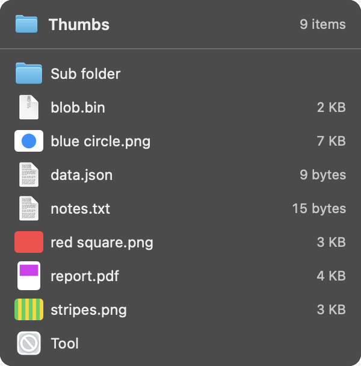

# P6.1 · Thumbnails in the rows

[← Back to the overview](../README.md) · Step tracker: [rollout/](README.md) · Plan:
[P6.1](../03-rollout-plan.md#p61-thumbnails) · Before this: [P5.1 · Finder windows in icon view](P5.1-finder-windows-icon-view.md)

Step 1 of [Phase P6](../03-rollout-plan.md#phase-p6-a-richer-panel). Pictures, PDFs and videos in the panel now show
**a small preview of their content** instead of a generic icon. The previews come from macOS's own Quick Look
thumbnails, the same ones Finder uses. They arrive in the background, so the panel opens as fast as before and they
fill in a moment later. Everything else keeps its Finder icon ([D9](../03-rollout-plan.md#decisions)).



*The test folder, snapshotted by Glimpse itself on 2026-11-24. The frosted background is missing because a view
snapshot can't see behind the window.*

```
panel opens ──▶ rows on screen ──▶ folder? keep its icon
                                   picture / PDF / video? (ThumbnailPolicy) ── no ─▶ keep its icon
                                         │ yes
                                         ▼
                      cached (same file, same modification date)? ── yes ─▶ show it
                                         │ no
                                         ▼
                      Quick Look draws it in its own process ──▶ show it, cache it   (nothing? keep the icon)
```

## What changed

| File | Change |
|---|---|
| [Sources/GlimpseCore/ThumbnailPolicy.swift](../../Sources/GlimpseCore/ThumbnailPolicy.swift) (new) | Which files get a preview: anything that is a picture, a PDF or audio/video (by its type, `UTType`). |
| [Sources/Glimpse/Thumbnails.swift](../../Sources/Glimpse/Thumbnails.swift) (new) | Asks Quick Look (`QLThumbnailGenerator`) for a 24-point preview at the screen's pixel density; caches up to 500 by file and modification date. |
| [Sources/Glimpse/PreviewPanel.swift](../../Sources/Glimpse/PreviewPanel.swift) | Rows 28 points tall (were 22) with 24-point images (were 16). Each row asks for its preview when it appears on screen, and the request is cancelled if the row goes away. A `snapshot` helper, for tests. |
| [Sources/Glimpse/FolderListing.swift](../../Sources/Glimpse/FolderListing.swift) | Each item also carries its modification date and type. |
| [Sources/Glimpse/AppDelegate.swift](../../Sources/Glimpse/AppDelegate.swift) | Developer option `--snapshot <png>` (with `--simulate-hover`): saves the panel as an image 2 s later. |
| [Tests/GlimpseCoreTests/ThumbnailPolicyTests.swift](../../Tests/GlimpseCoreTests/ThumbnailPolicyTests.swift) (new) | 3 tests over 18 file types. |

## Why only pictures, PDFs and videos

The first version asked Quick Look for every file. In the snapshot, `notes.txt` and `data.json` came out as **blank
white squares**: at 24 points a page of text is unreadable, and that said less than the file icon did. A picture, a
PDF's first page or a video frame is still recognisable at that size. So previews are limited to those, and text,
code, data, archives, apps and unknown files keep their icon. Rows grew from 22 to 28 points so a preview is worth
looking at; with 12 rows the panel is 388 points tall instead of 316. This is [D9](../03-rollout-plan.md#decisions),
proposed: easy to change if you'd rather have compact rows.

## Tests (2026-11-24)

Test folder (in the scratchpad): three drawn PNGs, a 2-page PDF, a text file, a JSON file, an unknown binary, a
subfolder and a fake app.

```bash
cd Glimpse
swift test
./build.sh
open -g ~/Applications/Glimpse.app --args --simulate-hover "<folder>" 1380 60 64 64 --snapshot /tmp/panel.png
```

| Check | Result |
|---|---|
| Clean build; `swift test` | ✅ 0 warnings; **51 tests in 10 suites** |
| Pictures | ✅ `blue circle.png`, `red square.png`, `stripes.png` show their content ([snapshot](img/P6.1-thumbnails-panel.png)) |
| PDF | ✅ `report.pdf` shows its first page |
| Text and data | ✅ `notes.txt`, `data.json` keep their document icon (after the fix above) |
| Unknown file, subfolder, app | ✅ `blob.bin`, `Sub folder`, `Tool` keep their icons |
| Panel speed | ✅ shown 27–92 ms after the simulated rest, as before; previews fill in afterwards |
| Doesn't take focus | ✅ Glimpse not active |

## Worth knowing

- **Quick Look reads the file to draw its preview**, in its own process. Glimpse still never changes a file
  ([D6](../03-rollout-plan.md#decisions)).
- **Big folders stay cheap.** Only rows on screen ask for a preview; scrolling asks for more. A row that scrolls away
  cancels its request.
- **The cache lives as long as Glimpse runs** (up to 500 previews). A file that changes gets a new preview, because its
  modification date is part of the key.
- **Quick Look plug-ins count.** If an app adds previews for its own file type, they show up here only if that type
  is a picture, a PDF or a video.

## Still to do

- **You:** rest on a folder of photos or screenshots and see the previews. Tell me if the rows feel too tall.
- Still open from earlier: [P5.1 in a live window](P5.1-finder-windows-icon-view.md#check-it-yourself-3-minutes), the
  external display, the desktop's top row, a file click, log out/in.

Next: [P7.1 · Icon, About window, README](P7.1-icon-about-readme.md).
